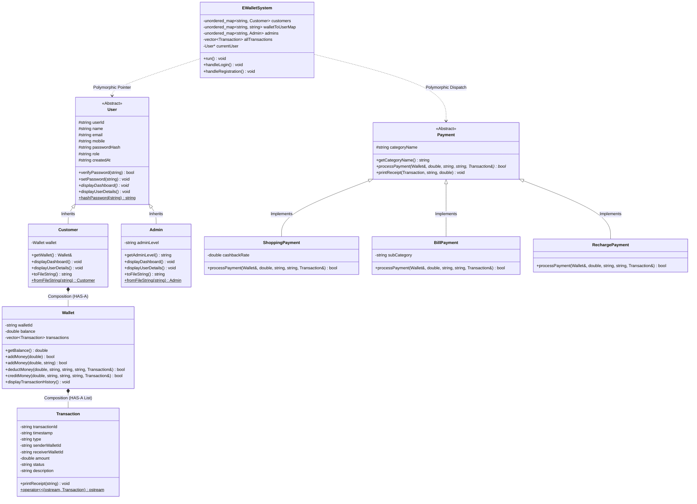

# SmartPay – E-Wallet Payment System
**Course:** Object-Oriented Programming with C++ (BTech CSE Project)  
**Standard:** ISO C++17  
**Architecture:** Object-Oriented, Modular Layered Architecture  

---

## 1. Project Overview

**SmartPay** is a production-grade, modular, menu-driven digital wallet application written in standard C++17. Designed as an exemplary BTech CSE semester project, it models real-world fintech systems like Paytm, Google Pay, and PayPal by providing secure multi-user registration, session authentication, peer-to-peer (P2P) transfers, multi-category payments (shopping, utilities, mobile recharges), full transaction ledger auditing, and an administrator governance console.

### Key Highlights
- **100% Native Standard C++17**: Built with standard library components (STL `unordered_map`, `vector`, `memory`, `regex`, `<chrono>`), requiring zero third-party packages or external database servers.
- **Cryptographic Security**: Implements standard SHA-256 hashing with salting for user credentials. Plaintext passwords are never stored in memory or on disk.
- **ACID-like File Persistence**: Auto-saves every transaction, user profile, and wallet balance to structured flat files (`data/users.txt`, `data/wallets.txt`, `data/transactions.txt`, `data/admin.txt`) ensuring resilience across application restarts.
- **Robust Input Sanitization**: Prevents infinite loops, buffer overflows, negative amounts, self-transfers, and invalid email or mobile formats.

---

## 2. Object-Oriented Programming (OOP) Concepts Implementation

SmartPay is designed to demonstrate all major pillars of Object-Oriented Programming:

| OOP Concept | Practical Implementation in SmartPay | Class / Location |
| :--- | :--- | :--- |
| **Encapsulation** | Private attributes (`balance`, `passwordHash`, `transactions`), protected with public getters and mutators. Outside code cannot directly alter wallet balance. | `Wallet`, `User`, `Transaction` |
| **Inheritance** | Base class `User` encapsulates common credentials and metadata. Derived classes `Customer` and `Admin` reuse base logic and add specialized behaviors. | `User` $\rightarrow$ `Customer`, `Admin` |
| **Runtime Polymorphism** | Pure virtual and virtual member functions (`displayDashboard()`, `displayUserDetails()`). Base pointer `User* currentUser` dynamically dispatches calls via the vtable at runtime. | `User* currentUser` in `EWalletSystem` |
| **Abstraction** | Abstract base class `Payment` defines the contract with pure virtual `processPayment(...)`. Derived classes encapsulate payment rules, rewards, and biller validation. | `Payment` $\rightarrow$ `ShoppingPayment`, `BillPayment`, `RechargePayment` |
| **Composition** | `Customer` **HAS-A** `Wallet` object as a member attribute. `Wallet` **HAS-A** collection of `Transaction` objects. | `Customer::wallet`, `Wallet::transactions` |
| **Function Overloading** | Overloaded `addMoney` methods with varying signatures (`amount` only vs. `amount` with descriptive remarks). | `Wallet::addMoney(double)` and `Wallet::addMoney(double, const string&)` |
| **Operator Overloading** | Overloaded stream insertion `operator<<` to render formatted tabular ledger records directly to streams. | `operator<<(ostream&, const Transaction&)` |
| **Constructors & Destructors**| Parameterized constructors with member initializer lists; `virtual ~User()` and `virtual ~Payment()` to guarantee clean heap teardown. | All classes |

---

## 3. Class Hierarchy & Architecture Diagram



---

## 4. Class Responsibilities

1. **`User` (Abstract Base Class)**
   - Encapsulates common user attributes (ID, name, email, mobile, hashed password, role, creation timestamp).
   - Enforces polymorphic behavior via pure virtual `virtual void displayDashboard() = 0;`.
   - Contains a cryptographically sound, zero-dependency `hashPassword` static utility using SHA-256 and salt.

2. **`Customer` (Derived from `User`)**
   - Represents standard wallet owners.
   - Composes a private `Wallet` object.
   - Implements customer-specific menus, balances, and profile inspectors.

3. **`Admin` (Derived from `User`)**
   - Represents system managers and financial compliance auditors.
   - Holds administrator authority levels.
   - Strictly obeys the Principle of Least Privilege: **Admins have zero access to customer passwords and cannot arbitrarily modify balances.**

4. **`Wallet`**
   - Encapsulates monetary storage.
   - Manages fund addition, balance validation, deductions, and transfer crediting.
   - Maintains an internal ledger (`std::vector<Transaction>`).

5. **`Transaction`**
   - Stores immutable financial event records (TXN ID, timestamp, type, sender, receiver, amount, status, notes).
   - Overloads `operator<<` for aligned table output.
   - Formats customer and merchant transaction receipts.

6. **`Payment` (Abstract Base Class) & Derived Payment Types**
   - **`ShoppingPayment`**: Implements dynamic cashback rewards (e.g., 5% bonus reward credited to wallet on retail/dining orders).
   - **`BillPayment`**: Handles utility billers (electricity, water, broadband) with consumer account validation and no hidden fees.
   - **`RechargePayment`**: Handles prepaid cellular plans and DTH with 10-digit mobile number validation.

7. **`EWalletSystem` (System Controller)**
   - Manages the program lifecycle, authentication loop, and runtime navigation.
   - Manages state synchronization between memory and persistent storage files.

---

## 5. File Handling & Storage Architecture

SmartPay uses structured pipe-delimited (`|`) text files inside the `data/` directory:

1. **`data/users.txt`**: Customer accounts  
   `userId|name|email|mobile|passwordHash|role|walletId|createdAt`
2. **`data/wallets.txt`**: Wallet balances  
   `walletId|userId|balance`
3. **`data/transactions.txt`**: Global audit ledger  
   `transactionId|timestamp|type|senderWalletId|receiverWalletId|amount|status|description`
4. **`data/admin.txt`**: System administrators  
   `adminId|name|email|mobile|passwordHash|role|adminLevel|createdAt`

---

## 6. Pre-Seeded Demonstration Accounts

When launched for the first time or if files are empty, SmartPay automatically seeds pre-configured demo accounts for immediate testing:

| Role | User ID | Password | Name | Wallet ID | Starting Balance |
| :--- | :--- | :--- | :--- | :--- | :--- |
| **Customer** | `user1` | `User1@123` | Milind | `SP10001` | Rs. 5,000.00 |
| **Customer** | `user2` | `User2@123` | Aarav Patel | `SP10002` | Rs. 3,500.00 |
| **Customer** | `user3` | `User3@123` | Priya Singh | `SP10003` | Rs. 2,000.00 |
| **Admin** | `admin` | `Admin@123` | Chief Administrator | *N/A (Auditor)* | *N/A* |

---

## 7. Compilation and Execution

### Using GCC / MinGW (C++17)
```bash
# Navigate to project directory
cd SmartPay

# Compile all source files
g++ -std=c++17 -Wall -Wextra -O2 main.cpp User.cpp Customer.cpp Admin.cpp Wallet.cpp Transaction.cpp Payment.cpp EWalletSystem.cpp -o smartpay.exe

# Execute application
./smartpay.exe
```

### Using Clang / LLVM
```bash
clang++ -std=c++17 -Wall -O2 main.cpp User.cpp Customer.cpp Admin.cpp Wallet.cpp Transaction.cpp Payment.cpp EWalletSystem.cpp -o smartpay.exe
./smartpay.exe
```

### Using Microsoft Visual C++ (MSVC / cl.exe)
```cmd
cl /EHsc /std:c++17 main.cpp User.cpp Customer.cpp Admin.cpp Wallet.cpp Transaction.cpp Payment.cpp EWalletSystem.cpp /Fe:smartpay.exe
smartpay.exe
```

---

## 8. Test Cases & Verification Matrix

| Test Case | Scenario / Input | Expected Result | Verified Status |
| :--- | :--- | :--- | :--- |
| **TC-01** | Register new user with unique ID, valid email, and 10-digit mobile | Account created, unique wallet ID (e.g. `SP10004`) generated, saved to file | Pass |
| **TC-02** | Register duplicate user ID (`user1`) | Rejected with clear duplicate error message | Pass |
| **TC-03** | Login with valid credentials (`user1` / `User1@123`) | Authenticated successfully, displays customer dashboard | Pass |
| **TC-04** | Login with incorrect password | Rejected with `Invalid password entered! Access denied` | Pass |
| **TC-05** | Add Money (Rs. 1,500) to wallet | Balance increases by 1,500, transaction `TXN...` created, receipt printed | Pass |
| **TC-06** | Add Money with negative amount (`-200`) | Rejected with `Deposit amount must be strictly positive` | Pass |
| **TC-07** | Send Money: valid recipient (`SP10002`), Rs. 1,000 | Sender deducted Rs. 1,000, recipient credited Rs. 1,000, ledger updated for both | Pass |
| **TC-08** | Send Money to non-existent wallet ID (`SP99999`) | Rejected with `Receiver Wallet ID does not exist` | Pass |
| **TC-09** | Send Money to own wallet ID (`SP10001`) | Rejected with self-transfer prohibition error | Pass |
| **TC-10** | Send Money with amount exceeding available balance | Rejected with `Insufficient wallet balance!` | Pass |
| **TC-11** | Shopping Payment $\ge$ Rs. 500 (e.g. Rs. 800) | Deducted Rs. 800, 5% cashback (Rs. 40) automatically credited back to wallet | Pass |
| **TC-12** | Mobile Recharge with invalid number (`12345`) | Rejected with `Mobile recharge requires a valid 10-digit number` | Pass |
| **TC-13** | Admin login (`admin` / `Admin@123`) | Accesses admin portal; views system liquidity, audit ledger, no passwords shown | Pass |
| **TC-14** | Restart application | All accounts, balances, and transaction history persist intact from files | Pass |

---

## 9. Viva Voce Questions & Answers Guide

1. **Q: Why is runtime polymorphism advantageous in this design?**  
   *A:* In `EWalletSystem`, the pointer `User* currentUser` can point to an instance of `Customer` or `Admin`. Calling `currentUser->displayDashboard()` uses dynamic dispatch (via the vtable) to invoke the correct dashboard without brittle `if-else` or `switch` statements checking user types.

2. **Q: What is the difference between Composition and Inheritance in SmartPay?**  
   *A:* `Customer` inherits from `User` because a customer **IS-A** user. However, `Customer` contains a `Wallet` member object because a customer **HAS-A** wallet (Composition). If a Customer object is deleted, its Wallet is automatically destroyed with it.

3. **Q: Why is `Payment` an Abstract Base Class?**  
   *A:* `Payment` contains a pure virtual function `processPayment(...) = 0`. It provides a common interface contract so that `EWalletSystem` can invoke any payment method (`ShoppingPayment`, `BillPayment`, `RechargePayment`) uniformly through a `Payment*` or `std::unique_ptr<Payment>` without knowing the internal rules of each biller or reward mechanism.

4. **Q: Why are destructors in base classes declared `virtual`?**  
   *A:* If a derived class object is deleted through a base class pointer (`User*` or `Payment*`), a non-virtual destructor results in undefined behavior where only the base destructor is invoked, causing memory leaks. A virtual destructor ensures the derived class destructor executes first, followed by the base class.

5. **Q: How does SmartPay maintain Encapsulation of user balances?**  
   *A:* The `balance` variable in `Wallet` is strictly `private`. External classes cannot assign directly to it (`wallet.balance = 50000;` will fail at compile time). Balances are updated only through controlled member functions (`addMoney()`, `deductMoney()`, `creditMoney()`) that enforce rigorous validation rules.

